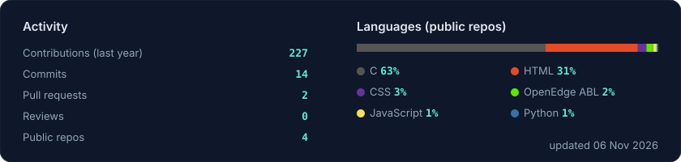

  

  
  
  
  

---

### Hi, I'm Vivek 👋

I'm a backend and infrastructure engineer with 15+ years of building systems where failure gets noticed: packet inspection at line rate, malware sandboxes, physical access control, and most recently national healthcare data exchange.

- 🏥 **Most recently:** Principal Member of Technical Staff at **Oracle Health**. I led a team of 4 building the **TEFCA QHIN** platform (initiating and responding gateways, XUA, SMART on FHIR v2) through **Sequoia Project RCE certification**.
- 🤖 **Now:** building agentic AI workflows that run in production, and **ForgeLayer**, which automates business processes with AI and APIs.
- 🌱 **Before that:** security (Zscaler, Fortinet, Sandvine, Procera), access control (Motorola Solutions), and carbon accounting SaaS (BMO Radicle).
- 💬 **Ask me about:** TEFCA/QHIN and FHIR, Kafka-backed audit pipelines, conformance-test automation, and how to get LLMs to do useful work instead of demos.

### 🛠️ Selected work

| Where | What I shipped |
| --- | --- |
| **Oracle Health** | TEFCA QHIN gateway platform in Java; Kafka decoupling audit-event emission from persistence (365-day compliance trail); automated conformance testing with interoperability partners |
| **Zscaler** | Automated test infrastructure for DLP across ZIA and ZPA |
| **BMO Radicle** | Rails and React SaaS for carbon accounting and climate tech |
| **Motorola Solutions** | Access control platform in Rails (Sidekiq, state machines, RSpec), JWT authN/authZ, a unified Flexera licensing service across two product lines |
| **Fortinet** | Automation to take the sandbox through NSS Labs certification: detection and false-positive rates across throughput tiers up to 100 Gbps, analyzed in Redshift |
| **Procera / Sandvine** | Deep packet inspection in C and Python, network capture, demos with solution engineers |

### 🚀 Things I'm building

| Project | What it is | Stack |
| --- | --- | --- |
| **ForgeLayer** | AI + API automation for repetitive business processes | Next.js · FastAPI · Supabase · Vercel |
| **[cruiseoutfits.com](https://cruiseoutfits.com)** | AI cruise wardrobe planner, day by day | Next.js · Python · Docker · Nginx |
| **[findcryptoatms.com](https://findcryptoatms.com)** | Location-data site for crypto ATMs (plus temple and EV-station datasets) | Location data · SEO |
| **Agent workflows** | n8n agents for a daily job digest (Greenhouse/Ashby) and LinkedIn engagement drafts, self-hosted on a Mac mini | n8n · Docker · Claude |
| **Options pipeline** | Semi-automated options strategy on the IBKR API with an LLM in the loop | Python · IBKR API · Claude |
| **FOSS Linux for kids in India** | Linux on low-cost hardware for children in India | Linux · FOSS |

### 🧰 Tech I use

  
   
  

### 📈 GitHub

  

  

### 🎓 Background

MASc, University of Victoria: research on vehicular ad hoc networks (VANETs), with one IEEE publication. Gen AI certified.

Off the keyboard I travel and play cricket and table tennis.
